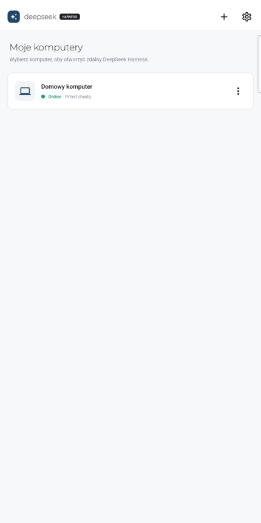
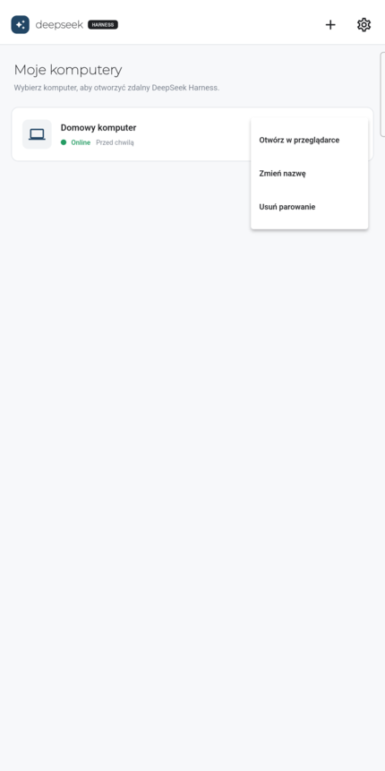
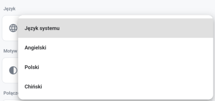
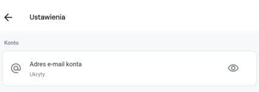

# Localization update — change summary

Prepared: 2026-10-20

This document describes the source changes prepared for the next GitHub publication of the suite. It is a change summary, not a signed release note: the unified release workflow still requires the Plugin, Relay, and Mobile package versions to match the pushed `v*` tag.

## Screenshots from a physical device

Captured on the connected Android phone (Samsung Galaxy S24 Ultra) from the local build of this change set. The account e-mail, Relay address, system notifications, and system bars are cropped or excluded. Device names, paths, and technical codes stay untranslated by design.

| Polish device list | English device list | Chinese device list |
| --- | --- | --- |
|  |  |  |

| Polish computer actions | Polish language selector |
| --- | --- |
|  |  |



The computer actions menu shows the browser-access entry added in 0.1.5 alongside rename and unpair. The language selector is the new session-level control that switches English, Polish, and Simplified Chinese without restarting the app.

## dsh-mobile (Flutter client)

### Added

- Localization catalogs in `lib/l10n/en.json`, `lib/l10n/pl.json`, and `lib/l10n/zh.json`, loaded before the first frame through `AppLocalizations`.
- System-language selection with a deterministic English fallback for unsupported locales. Explicit language and theme choices are persisted locally in secure storage and never migrate accounts or rewrite credentials.
- Language and theme selectors in Settings. Both controls re-render the app without restarting it, and the stored choice is applied before the first frame on the next launch.
- The signed-in e-mail in Settings is hidden by default (`Ukryty`) and revealed only for the current visit with the eye button.
- Locale-aware relative timestamps and plural forms (`minutę/minuty/minut`, `godzinę/godziny/godzin`) instead of a single hardcoded pattern.
- Localized API error mapping. Backend prose is never rendered; reason codes map to catalog keys.
- Preserved language, theme, and requested path when the app hands a device to the browser or remote-files page (`session_target.dart`, `remote_files_path.dart`).

### Changed

- Replaced hardcoded Chinese display copy across login, pairing, device list, settings, update prompts, and session screens with catalog lookups.
- Reworked the theme layer into one palette/token owner for light and dark surfaces. Widgets read semantic colors instead of local constants.

### Fixed

- The rename dialog disposed its `TextEditingController` immediately after `showDialog` returned, while the dialog route was still animating. That produced a `TextEditingController was used after being disposed` error followed by the framework assertion `_dependents.isEmpty`. The controller is now owned by a stateful dialog and disposed with its route.
- The DSH session WebView now ends above the Android system navigation bar, so the sidebar footer, task composer, and status strip stay visible and tappable. Regression test: `test/session_webview_insets_test.dart`.
- Regression test: `test/rename_dialog_test.dart`.

### Documentation

- Added `README.pl.md` and language links to the English and Chinese READMEs.
- Replaced the device-list screenshot with a current, sanitized capture.

## dsh-plugin (DSH plugin and Companion)

### Added

- Runtime localization for the plugin settings page and the remote file manager: English, Polish, and Simplified Chinese, selected from the browser language or the visible selector.
- Extracted the file-manager HTML into `src/file-browser.ts` and the DSH browser-cookie handling into `src/dsh-browser-cookie.ts` so both pages have one owner and can be tested in isolation.
- Tests for browser-cookie handling, file listing, and localization (`test/browser-cookie.test.ts`, `test/files-listing.test.ts`, `test/localization.test.ts`).

### Changed

- Localized labels, empty states, errors, date/time/size formatting, and accessible names. Device names, file paths, file contents, URLs, and machine reason codes remain untranslated.
- The language preference is stored per browser when local storage is available; no account, pairing, or credential data is touched.
- Rebuilt `dist/` from the merged sources.

### Documentation

- Added `README.pl.md`, corrected its install version references to `v0.1.9`, and linked it from the English and Chinese READMEs.

## dsh-relay

### Added

- `web/app/i18n.js`, a shared catalog for the Relay browser app, administration page, and session-unavailable page.
- A visible language selector before and after sign-in, persisted as `dsh-relay-language`, with `navigator.languages` fallback and English as the final fallback.
- Service-worker localization, including a localized `secure_tunnel_failed` response with `Content-Language` and `Cache-Control: no-store`.
- `test/i18n.test.ts` and a CSP test that allows the same-origin `/app/i18n.js` asset without weakening the existing policy.

### Changed

- Merged the upstream browser-refresh recovery (`v0.1.9`) with the localized tunnel-failure path. A failed request still attempts one reconnect for `GET`/`HEAD`; non-idempotent requests fail with the localized 502 response.
- Locale never enters tunnel envelopes, authentication requests, or stored credentials. It is presentation metadata only.

### Documentation

- Added `README.pl.md` and language links.

## dsh-website

### Added

- Polish routes under `/pl/`: home, download, how-it-works, security, self-hosted Relay, privacy, terms, blog index, and the three product articles.
- Locale-aware navigation, header/footer links, metadata, and alternative text.
- `scripts/check-locales.mjs` (`npm run check:locales`) to verify route and copy parity, internal links, metadata, accessible names, and obvious untranslated copy.

### Changed

- English stays the default locale and the existing Chinese homepage remains available. Polish pages link back to the matching English routes where a translated destination does not exist.

### Documentation

- Added `README.pl.md` and documented the locale checks.
- Replaced the device-list image with a current, sanitized capture.

## Suite documentation and privacy review

### Documentation

- Added Polish root documents: `README.pl.md`, `CHANGELOG.pl.md`, `CONTRIBUTING.pl.md`, `SECURITY.pl.md`, with language links in the English and Chinese files.
- Added this change summary in English and Polish, and linked it from the root README and changelog.

### Privacy

- Screenshots were cropped to remove the status bar (time, notifications, carrier) and the navigation bar. The account e-mail, Relay address, access tickets, and device identifiers are not present. The Settings capture shows the default `Ukryty` state; the address is rendered only after tapping the eye button.
- The visible computer name in the captures is the neutral `Domowy komputer`; no account holder name is shown.
- PNG metadata was stripped before commit.
- Language and theme preferences are stored as two local values in the app's secure storage; they never contain account, pairing, or Relay credentials.
- The real LAN address in `dsh-mobile/test/pair_payload_parser_test.dart` was replaced with the documentation range `192.0.2.10`.
- Aegis working records under `docs/aegis/` contain local paths, LAN addresses, and device details. They are now ignored by git and are not part of the publication.
- No credentials, tokens, JWTs, or private keys were found in the tracked working tree.

## Verification

| Component | Command | Result |
| --- | --- | --- |
| dsh-mobile | `dart format --set-exit-if-changed`, `flutter analyze`, `flutter test` | format and analyze clean; 64 tests passed |
| dsh-plugin | `npm run build` + `npm test` | build OK, 38 tests passed |
| dsh-relay | `npm run build` + `npm test` | build OK, 31 tests passed |
| dsh-website | `npm run check` | Astro, ESLint, and Prettier pass |
| dsh-website | `npm run build` + `npm run check:locales` | 34 pages built; 3 copy shapes, 23 localized outputs, and 1056 local links checked |

The screenshots come from a debug build installed on the phone. The rename-dialog fix is covered by its widget test; a fresh signed APK was not produced in this workspace.

## Release status and remaining steps

- The four `release/localization` branches are pushed to the `AndrewSpec` forks and are the submodule origins.
- `.gitmodules` points at those forks, so cloning the suite fork with submodules resolves the new commits.
- `april-jk` remains the upstream and is read-only for this account; publishing there would require write access or merged PRs.
- The unified release tag cannot be created yet: Mobile is `0.1.5`, while Plugin and Relay are `0.1.9`. The release workflow rejects a tag unless all three match. Align the versions (for example `0.1.10`) before tagging.
- The suite branch is not pushed yet.
- Website deployment and Android release signing remain release-time steps.

```bash
# Component branches are already pushed to the AndrewSpec forks.
git push origin main
```
